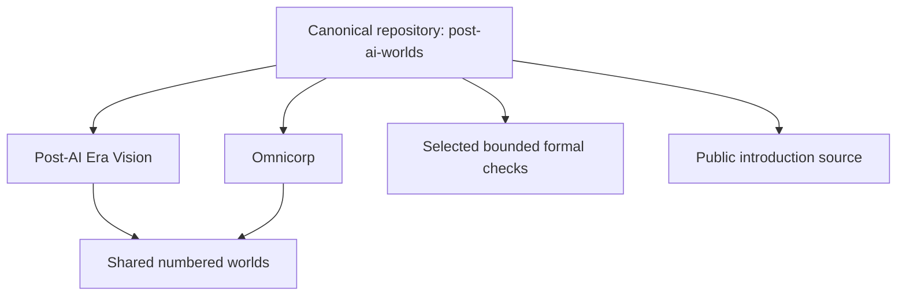

# Canonical project navigation

**[Post-AI Era Vision & Omnicorp](https://github.com/sloik/post-ai-worlds) is the one maintained home for both projects.**

| Destination | Owning source |
|---|---|
| Society and its possible futures | [post-ai/](../post-ai/README.md) |
| The organisation and its development | [omnicorp/](../omnicorp/README.md) |
| Shared assumptions, scope and numbered worlds | [worlds/](../worlds/README.md) |
| Exact formal assurance boundary | [formal/](../formal/README.md) |
| Forecast discipline and contributions | [Forecasting guide](../docs/forecasting-guide.md) |
| Website authoring/build source | [website/](../website/README.md) |

[Machine-readable navigation graph](canonical-navigation.json) records tracked public Markdown documents, source hashes and simple inline Markdown links outside frontmatter, fenced blocks and inline code. This is not a complete CommonMark parser. The two canonical-track relationships come directly from [CANONICAL.md](../CANONICAL.md). It is document navigation, not semantic extraction, scientific evidence or formal proof. Private knowledge graphs and their contents are not included.

Run `python3 tools/build_navigation.py` to validate it, or `python3 tools/build_navigation.py --write` after a reviewed documentation change. The graph needs Git's tracked file list, not private history. It ignores untracked notes and generated `graphs/` inputs; this README is explanatory navigation rather than a claim that every illustrated high-level relationship was inferred from prose.

Historical private source/proof/forecast identities remain historical. A current home link does not mean every old source was published or every claim is true in a numbered world.
